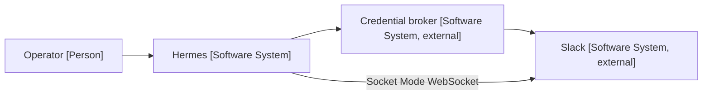
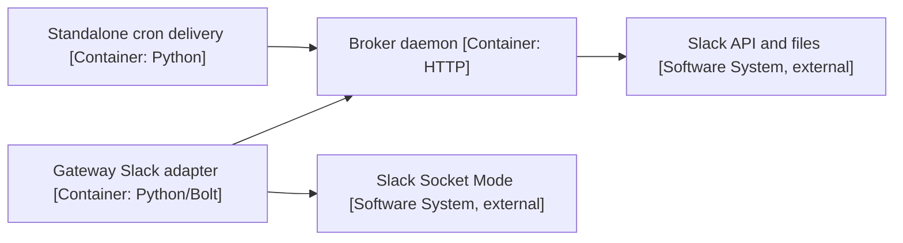

# Slack credential-broker transport

## 1 Introduction and goals

Hermes can participate in Slack without custody of bot or app-level tokens. Credential custody and predictable routing take priority over compatibility with every Slack CDN origin. Operators configure routes; Slack users retain their existing messaging interface.

## 2 Constraints

This integration extends the bundled Slack platform plugin on v0.23.0. Direct mode remains the default. The broker must implement Slack Web API paths and inject upstream credentials. Live agent cutover is outside this code change.

## 3 Context and scope

The operator provisions credentials in a broker and configures Hermes to use it.

Not yet documented here: model calls, other platform plugins, gateway session ownership, and broker internals. Existing developer architecture documentation describes the wider system.

## 4 Solution strategy

An optional `PlatformConfig.extra.broker` mapping selects broker mode explicitly. The configuration is validated before use; it never falls back to saved Slack tokens. A separate files base URL keeps attachment destinations independent of the Web API route. See `plugins/platforms/slack/broker_transport.py:21` (`BrokerTransport.from_config`).

## 5 Building block view

The Slack adapter owns transport selection; the broker owns Slack credential injection.

### 5.2 Interfaces

The operator supplies `api_base_url`, `socket_base_url`, `files_base_url`, and either an `agent_token_file` or profile-scoped `SLACK_BROKER_TOKEN`. URLs are absolute HTTP(S), without embedded credentials, query or fragment. Bearers never appear in object representations. Web API methods append to the API route. `apps.connections.open` uses the socket route and returns the direct WebSocket URL. File paths and queries from HTTPS `files.slack.com` URLs append to the files route; traversal, other origins and redirects are refused. SDK upload bytes carry the agent bearer through the files route. Contracts are exercised by `qa/smoke/slack_broker.py:21`; routing and destination checks live in `plugins/platforms/slack/broker_transport.py:53` and `plugins/platforms/slack/broker_transport.py:70`.

## 6 Runtime view

Gateway startup authenticates via the broker API route, starts Socket Mode with a separate WebClient on the socket route, then connects the WebSocket directly. The Bolt application client stays on the API route, including for proactive sends to channels not seen inbound. Bolt-created request clients receive the same transport configuration in `before_authorize`. Reconnect rebuilds workspace clients and ignores saved Slack tokens. Startup, reconnect and multiplex gates share the plugin registry config verdict through `gateway/run_adapter_credentials.py:7`, so a configured broker without a local Slack token can recover from a temporary outage. Standalone delivery binds broker configuration in a ContextVar so DM resolution, text and media delivery share routing without leaking configuration between concurrent tasks. `finally` restores the prior context (`plugins/platforms/slack/adapter.py:6845`). Bolt request routing is in `plugins/platforms/slack/adapter.py:819`; startup and socket setup are in `plugins/platforms/slack/adapter.py:1779` and `plugins/platforms/slack/adapter.py:1233`.

The send_message resolver receives the platform config before resolving `user:U...`, `user_name:@handle` and bare user home-channel targets. Its users.list and conversations.open calls use the same broker API route and bearer (`tools/send_message_senders.py:361`). Gateway sends and standalone cron sends both use this resolver.

## 7 Deployment view

The runtime needs network access to the broker and Slack WebSockets. The operator grants all three routes, provisions bot credentials on API/files routes and an app-level credential on the socket route. The agent bearer file belongs outside the checkout with mode 0600. Mira's build pin and production migration remain attended F-012 work.

## 8 Crosscutting concepts

Broker attachment paths are untrusted. Origin checks and repeated-decoding traversal checks confine them to a fixed files route. Configured broker destinations are trusted operator input and may use private addresses; file HTTP clients disable redirects and select proxies explicitly. Broker clients honor NO_PROXY against their actual destination rather than Slack hostnames (`plugins/platforms/slack/broker_transport.py:45`). Default direct-mode SSRF and redirect checks remain in force (`plugins/platforms/slack/adapter.py:6298`). Missing/invalid broker inputs report disconnected with a warning before direct-token fallback; connect records a non-retryable config error (`plugins/platforms/slack/adapter.py:1779`, `plugins/platforms/slack/adapter.py:6981`). The one-workspace deployment does not load `slack_tokens.json` in broker mode.

## 9 Architecture decisions

[ADR-0001: optional Slack credential-broker transport](adr/0001-slack-broker-transport.md) — accepted.

[ADR-0002: isolate broker clients and share credential availability](adr/0002-slack-broker-client-and-lifecycle-ownership.md) — accepted.

## 10 Quality requirements

Credential custody is verified by starting with no Slack tokens and a stale saved-token fixture. Routing is verified with real SDK/Bolt requests and a recording local broker that refuses Web API methods on the socket route. The smoke also exercises proactive messages, gateway and cron user targets, broker-host proxy bypass, and the gateway reconnect queue after a temporary outage. Compatibility is checked with existing Slack and media tests. Refusal tests cover malformed configuration, Slack tokens used as agent bearers, and file-route escape attempts.

## 11 Risks and technical debt

The files route supports `files.slack.com` only; Enterprise Grid origins and redirects fail explicitly. The broker's identity/workspace policies and deployment are separate responsibilities. HTTP broker links rely on the deployment's trusted network. SDK private upload methods and Bolt client construction are compatibility seams covered by smoke tests. This fork integration is not evidence of upstream acceptance.

## 12 Glossary

A broker stores upstream credentials and injects them on proxied requests. An agent bearer authenticates Hermes to that broker. Socket Mode delivers Slack events over a WebSocket after a Web API setup call.
